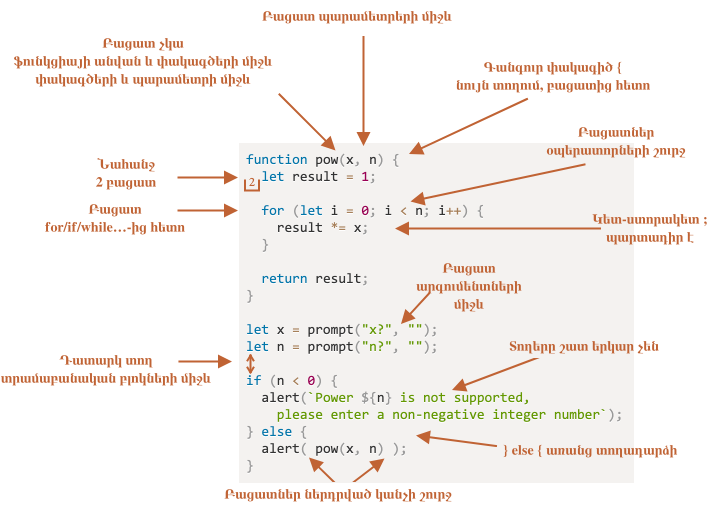

# Կոդավորման ոճ

Մեր կոդը պետք է լինի հնարավորինս մաքուր և հեշտ ընթեռնելի։

Սա իրականում ծրագրավորման արվեստն է. վերցնել բարդ խնդիր և գրել դրա կոդն այնպես, որ այն լինի և ճիշտ, և մարդու համար ընթեռնելի։ Կոդի լավ ոճը մեծապես օգնում է դրան։

## Շարահյուսություն

Ահա մի քանի առաջարկվող կանոններով համառոտ ուղեցույց (մանրամասները տես ստորև)՝


<!--
```js
function pow(x, n) {
  let result = 1;

  for (let i = 0; i < n; i++) {
    result *= x;
  }

  return result;
}

let x = prompt("x?", "");
let n = prompt("n?", "");

if (n < 0) {
  alert(`Power ${n} is not supported,
    please enter a non-negative integer number`);
} else {
  alert( pow(x, n) );
}
```

-->

Այժմ մանրամասն քննարկենք կանոնները և դրանց պատճառները։

```warn header="There are no \"you must\" rules"
Այստեղ ոչինչ քարի վրա գրված չէ։ Սրանք ոճային նախասիրություններ են, այլ ոչ թե կրոնական դոգմաներ։
```

### Ձևավոր փակագծեր

JavaScript-ի նախագծերի մեծ մասում ձևավոր փակագծերը գրվում են «եգիպտական» ոճով. բացվող փակագիծը գտնվում է համապատասխան հիմնաբառի հետ նույն տողում, այլ ոչ թե նոր տողում։ Բացվող փակագծից առաջ պետք է լինի նաև բացատ՝ այսպես՝

```js
if (condition) {
  // do this
  // ...and that
  // ...and that
}
```

Միատող կառուցվածքը, օրինակ՝ `if (condition) doSomething()`, կարևոր սահմանային դեպք է։ Արդյոք ընդհանրապես պե՞տք է օգտագործել փակագծեր։

Ահա մեկնաբանված տարբերակները, որպեսզի կարողանաք ինքնուրույն գնահատել դրանց ընթեռնելիությունը՝

1. 😠 Սկսնակները երբեմն այդպես են անում։ Վատ է։ Ձևավոր փակագծերը պետք չեն՝
    ```js
    if (n < 0) *!*{*/!*alert(`Power ${n} is not supported`);*!*}*/!*
    ```
2. 😠 Առանձին տողի բաժանում առանց փակագծերի։ Երբեք այդպես մի արեք, նոր տողեր ավելացնելիս հեշտ է սխալվել՝
    ```js
    if (n < 0)
      alert(`Power ${n} is not supported`);
    ```
3. 😏 Մեկ տող առանց փակագծերի՝ ընդունելի է, եթե կարճ է՝
    ```js
    if (n < 0) alert(`Power ${n} is not supported`);
    ```
4. 😃 Լավագույն տարբերակը՝
    ```js
    if (n < 0) {
      alert(`Power ${n} is not supported`);
    }
    ```

Շատ կարճ կոդի համար թույլատրվում է մեկ տողը, օրինակ՝ `if (cond) return null`։ Սակայն կոդի բլոկը (վերջին տարբերակը) սովորաբար ավելի ընթեռնելի է։

### Տողի երկարությունը

Ոչ ոք չի սիրում կարդալ կոդի երկար հորիզոնական տողեր։ Լավագույն պրակտիկան դրանք բաժանելն է։

Օրինակ՝
```js
// backtick quotes ` allow to split the string into multiple lines
let str = `
  ECMA International's TC39 is a group of JavaScript developers,
  implementers, academics, and more, collaborating with the community
  to maintain and evolve the definition of JavaScript.
`;
```

Իսկ `if` հրամանների համար՝

```js
if (
  id === 123 &&
  moonPhase === 'Waning Gibbous' &&
  zodiacSign === 'Libra'
) {
  letTheSorceryBegin();
}
```

Տողի առավելագույն երկարությունը պետք է համաձայնեցվի թիմի մակարդակով։ Սովորաբար դա 80 կամ 120 նիշ է։

### Ներքաշումներ

Ներքաշումները երկու տեսակ են՝

- **Հորիզոնական ներքաշումներ՝ 2 կամ 4 բացատ։**

    Հորիզոնական ներքաշումը կատարվում է կամ 2 կամ 4 բացատով, կամ հորիզոնական tab նիշով (ստեղն `key:Tab`)։ Թե որն ընտրել՝ հին «սրբազան պատերազմ» է։ Այսօր ավելի տարածված են բացատները։

    Բացատների մեկ առավելությունը tab-ի նկատմամբ այն է, որ բացատները թույլ են տալիս ներքաշումների ավելի ճկուն կարգավորումներ, քան tab նիշը։

    Օրինակ՝ պարամետրերը կարող ենք հավասարեցնել բացվող փակագծին՝ այսպես՝

    ```js no-beautify
    show(parameters,
         aligned, // 5 spaces padding at the left  
         one,
         after,
         another
      ) {
      // ...
    }
    ```

- **Ուղղահայաց ներքաշումներ՝ դատարկ տողեր՝ կոդը տրամաբանական բլոկների բաժանելու համար։**

    Նույնիսկ մեկ ֆունկցիան հաճախ կարելի է բաժանել տրամաբանական բլոկների։ Ստորև բերված օրինակում փոփոխականների սկզբնավորումը, հիմնական ցիկլը և արդյունքի վերադարձը բաժանված են ուղղահայաց՝

    ```js
    function pow(x, n) {
      let result = 1;
      //              <--
      for (let i = 0; i < n; i++) {
        result *= x;
      }
      //              <--
      return result;
    }
    ```

   Ավելացրեք լրացուցիչ նոր տող այնտեղ, որտեղ դա օգնում է կոդն ավելի ընթեռնելի դարձնել։ Ուղղահայաց ներքաշում չունեցող կոդի ինը տողից ավել չպետք է լինի։

### Կետ-ստորակետեր

Յուրաքանչյուր հրամանից հետո պետք է լինի կետ-ստորակետ, նույնիսկ եթե այն հնարավոր է բաց թողնել։

Կան լեզուներ, որտեղ կետ-ստորակետը իսկապես կամընտրական է և հազվադեպ է օգտագործվում։ Սակայն JavaScript-ում կան դեպքեր, երբ տողադարձը չի մեկնաբանվում որպես կետ-ստորակետ, ինչը կոդը խոցելի է դարձնում սխալների համար։ Այդ մասին ավելին տես <info:structure#semicolon> գլխում։

Եթե դուք փորձառու JavaScript ծրագրավորող եք, կարող եք ընտրել առանց կետ-ստորակետների կոդի ոճ, ինչպես [StandardJS](https://standardjs.com/)-ը։ Հակառակ դեպքում լավագույնն է օգտագործել կետ-ստորակետեր՝ հնարավոր թակարդներից խուսափելու համար։ Մշակողների մեծամասնությունը դնում է կետ-ստորակետեր։

### Ներդրման մակարդակներ

Փորձեք խուսափել կոդի չափազանց խորը ներդրումից։

Օրինակ՝ ցիկլում երբեմն լավ միտք է օգտագործել [`continue`](info:while-for#continue) հրահանգը՝ լրացուցիչ ներդրումից խուսափելու համար։

Օրինակ՝ այսպիսի ներդրված `if` պայման ավելացնելու փոխարեն՝

```js
for (let i = 0; i < 10; i++) {
  if (cond) {
    ... // <- one more nesting level
  }
}
```

We can write:

```js
for (let i = 0; i < 10; i++) {
  if (!cond) *!*continue*/!*;
  ...  // <- no extra nesting level
}
```

Նմանատիպ բան կարելի է անել `if/else`-ի և `return`-ի հետ։

Օրինակ՝ ստորև բերված երկու կառուցվածքները նույնական են։

Տարբերակ 1՝

```js
function pow(x, n) {
  if (n < 0) {
    alert("Negative 'n' not supported");
  } else {
    let result = 1;

    for (let i = 0; i < n; i++) {
      result *= x;
    }

    return result;
  }  
}
```

Տարբերակ 2:

```js
function pow(x, n) {
  if (n < 0) {
    alert("Negative 'n' not supported");
    return;
  }

  let result = 1;

  for (let i = 0; i < n; i++) {
    result *= x;
  }

  return result;
}
```

Երկրորդն ավելի ընթեռնելի է, քանի որ `n < 0` «հատուկ դեպքը» մշակվում է հենց սկզբում։ Երբ ստուգումն ավարտվում է, կարող ենք անցնել կոդի «հիմնական» հոսքին՝ առանց լրացուցիչ ներդրման անհրաժեշտության։

## Ֆունկցիաների տեղադրումը

Եթե գրում եք մի քանի «օժանդակ» ֆունկցիա և դրանք օգտագործող կոդը, ֆունկցիաները կազմակերպելու երեք եղանակ կա։

1. Ֆունկցիաները հայտարարել դրանք օգտագործող կոդից *վերև*՝

    ```js
    // *!*function declarations*/!*
    function createElement() {
      ...
    }

    function setHandler(elem) {
      ...
    }

    function walkAround() {
      ...
    }

    // *!*the code which uses them*/!*
    let elem = createElement();
    setHandler(elem);
    walkAround();
    ```
2. Սկզբում կոդը, հետո ֆունկցիաները

    ```js
    // *!*the code which uses the functions*/!*
    let elem = createElement();
    setHandler(elem);
    walkAround();

    // --- *!*helper functions*/!* ---
    function createElement() {
      ...
    }

    function setHandler(elem) {
      ...
    }

    function walkAround() {
      ...
    }
    ```
. Խառը՝ ֆունկցիան հայտարարվում է այնտեղ, որտեղ առաջին անգամ օգտագործվում է։

Շատ դեպքերում նախընտրելի է երկրորդ տարբերակը։

Դա այն պատճառով է, որ կոդ կարդալիս մենք նախ ուզում ենք իմանալ՝ *ինչ է այն անում*։ Եթե կոդը գալիս է առաջինը, դա պարզ է դառնում հենց սկզբից։ Այդ դեպքում գուցե ընդհանրապես կարիք չլինի կարդալ ֆունկցիաները, հատկապես եթե դրանց անունները նկարագրում են, թե իրականում ինչ են անում։

## Ոճի ուղեցույցներ

Ոճի ուղեցույցը պարունակում է կոդ «ինչպես գրելու» ընդհանուր կանոններ, օրինակ՝ ինչ չակերտներ օգտագործել, քանի բացատով ներքաշել, տողի առավելագույն երկարությունը և այլն։ Շատ մանր բաներ։

Երբ թիմի բոլոր անդամները նույն ոճի ուղեցույցն են օգտագործում, կոդը միասնական է երևում՝ անկախ այն բանից, թե թիմի որ անդամն է այն գրել։

Իհարկե, թիմը միշտ կարող է գրել սեփական ոճի ուղեցույցը, բայց սովորաբար դրա կարիքը չկա։ Գոյություն ունեն բազմաթիվ ուղեցույցներ, որոնցից կարելի է ընտրել։

Որոշ տարածված ընտրություններ՝

- [Google JavaScript Style Guide](https://google.github.io/styleguide/jsguide.html)
- [Airbnb JavaScript Style Guide](https://github.com/airbnb/javascript)
- [Idiomatic.JS](https://github.com/rwaldron/idiomatic.js)
- [StandardJS](https://standardjs.com/)
- (plus many more)

Եթե դուք սկսնակ մշակող եք, սկսեք այս գլխի սկզբի համառոտ ուղեցույցից։ Հետո կարող եք ուսումնասիրել այլ ոճի ուղեցույցներ՝ ավելի շատ գաղափարներ քաղելու և որոշելու համար, թե որն է ձեզ ամենաշատը դուր գալիս։

## Ավտոմատ լինտերներ

Լինտերները գործիքներ են, որոնք կարող են ավտոմատ ստուգել ձեր կոդի ոճը և առաջարկել բարելավումներ։

Դրանց հիանալի կողմն այն է, որ ոճի ստուգումը կարող է նաև գտնել որոշ սխալներ, օրինակ՝ փոփոխականների կամ ֆունկցիաների անուններում տպասխալներ։ Այս հատկության շնորհիվ լինտերի օգտագործումը խորհուրդ է տրվում, նույնիսկ եթե չեք ուզում հետևել որևէ կոնկրետ «կոդի ոճի»։

Ահա մի քանի հայտնի լինտինգի գործիքներ՝

- [JSLint](https://www.jslint.com/) -- առաջին լինտերներից մեկը։
- [JSHint](https://jshint.com/) -- JSLint-ից ավելի շատ կարգավորումներով։
- [ESLint](https://eslint.org/) -- հավանաբար ամենանորը։

Դրանցից յուրաքանչյուրը կարող է անել գործը։ Հեղինակն օգտագործում է [ESLint](https://eslint.org/)։

Լինտերների մեծ մասը ինտեգրված է շատ տարածված խմբագրիչների հետ. պարզապես միացրեք խմբագրիչի plugin-ը և կարգավորեք ոճը։

Օրինակ՝ ESLint-ի համար պետք է անեք հետևյալը՝

1. Տեղադրեք [Node.js](https://nodejs.org/)-ը։
2. Տեղադրեք ESLint-ը `npm install -g eslint` հրամանով (npm-ը JavaScript փաթեթների տեղադրիչ է)։
3. Ստեղծեք `.eslintrc` անունով կարգավորումների ֆայլ ձեր JavaScript նախագծի արմատում (այն թղթապանակում, որ պարունակում է ձեր բոլոր ֆայլերը)։
4. Տեղադրեք/միացրեք ձեր խմբագրիչի plugin-ը, որն ինտեգրվում է ESLint-ի հետ։ Խմբագրիչների մեծամասնությունն ունի այն։

Ահա `.eslintrc` ֆայլի օրինակ՝

```js
{
  "extends": "eslint:recommended",
  "env": {
    "browser": true,
    "node": true,
    "es6": true
  },
  "rules": {
    "no-console": 0,
    "indent": 2
  }
}
```

Այստեղ `"extends"` հրահանգը նշանակում է, որ կարգավորումը հիմնված է «eslint:recommended» կարգավորումների հավաքածուի վրա։ Դրանից հետո մենք նշում ենք մեր սեփականները։

Հնարավոր է նաև համացանցից ներբեռնել ոճի կանոնների հավաքածուներ և դրանք ընդլայնել։ Տեղադրման մասին ավելի մանրամասն տես <https://eslint.org/docs/user-guide/getting-started>։

Նաև որոշ IDE-ներ ունեն ներկառուցված լինտինգ, որը հարմար է, բայց ESLint-ի չափ կարգավորելի չէ։

## Ամփոփում

Այս գլխում նկարագրված (և նշված ոճի ուղեցույցներում առկա) բոլոր շարահյուսական կանոնները նպատակ ունեն բարձրացնել ձեր կոդի ընթեռնելիությունը։ Դրանք բոլորը վիճելի են։

Երբ մտածում ենք «ավելի լավ» կոդ գրելու մասին, հարցերը, որ պետք է տանք մեզ, հետևյալն են՝ «Ի՞նչն է կոդն ավելի ընթեռնելի և հեշտ հասկանալի դարձնում» և «Ի՞նչը կարող է օգնել մեզ խուսափել սխալներից»։ Սրանք հիմնական բաներն են, որ պետք է հաշվի առնել կոդի ոճեր ընտրելիս և քննարկելիս։

Տարածված ոճի ուղեցույցներ կարդալը թույլ կտա ձեզ տեղյակ մնալ կոդի ոճի միտումների և լավագույն պրակտիկաների մասին վերջին գաղափարներին։
